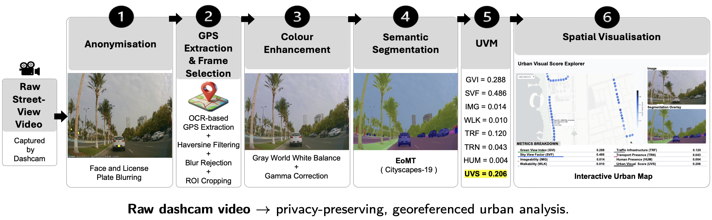
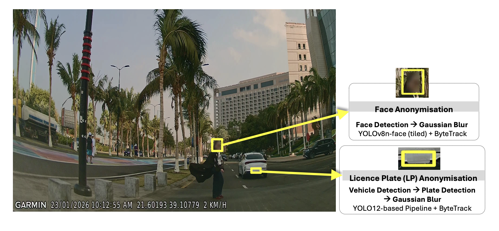
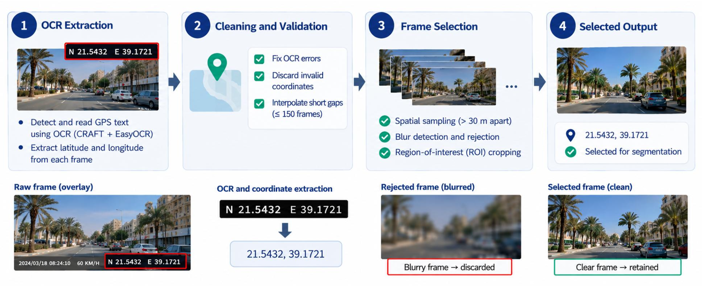
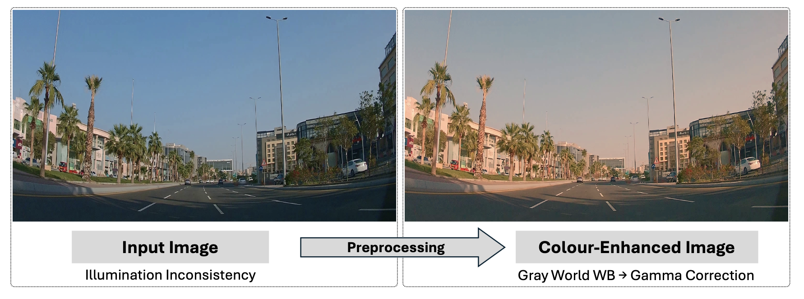
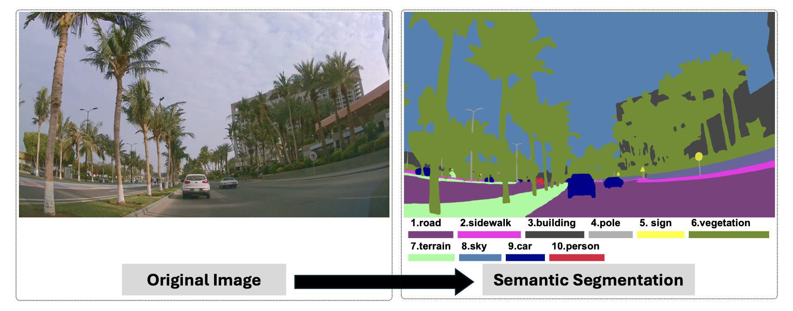
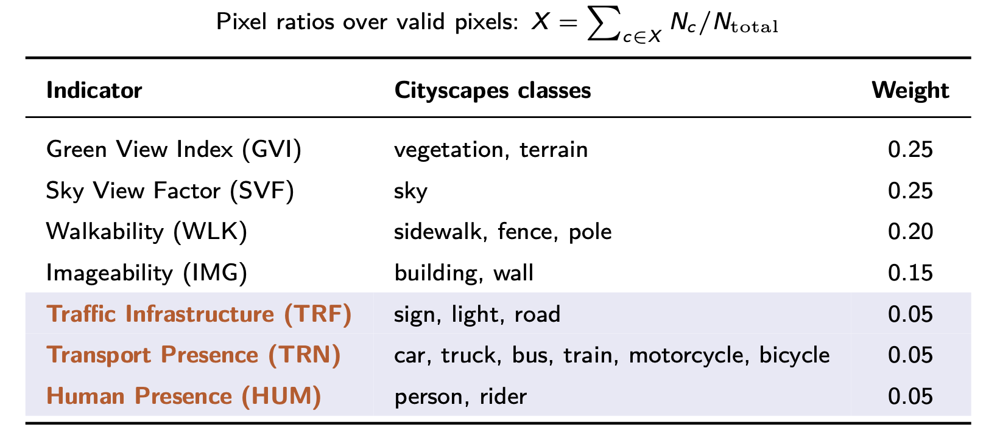
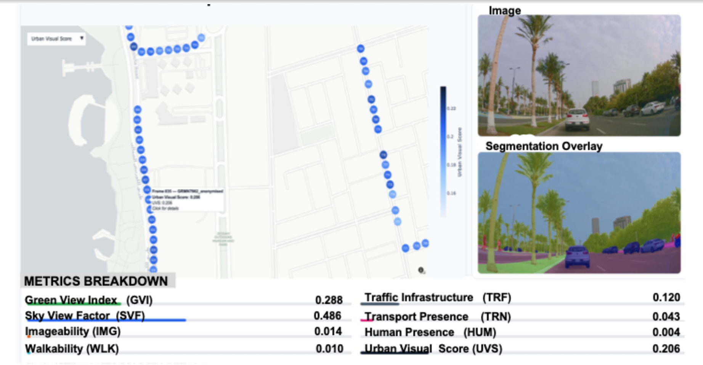
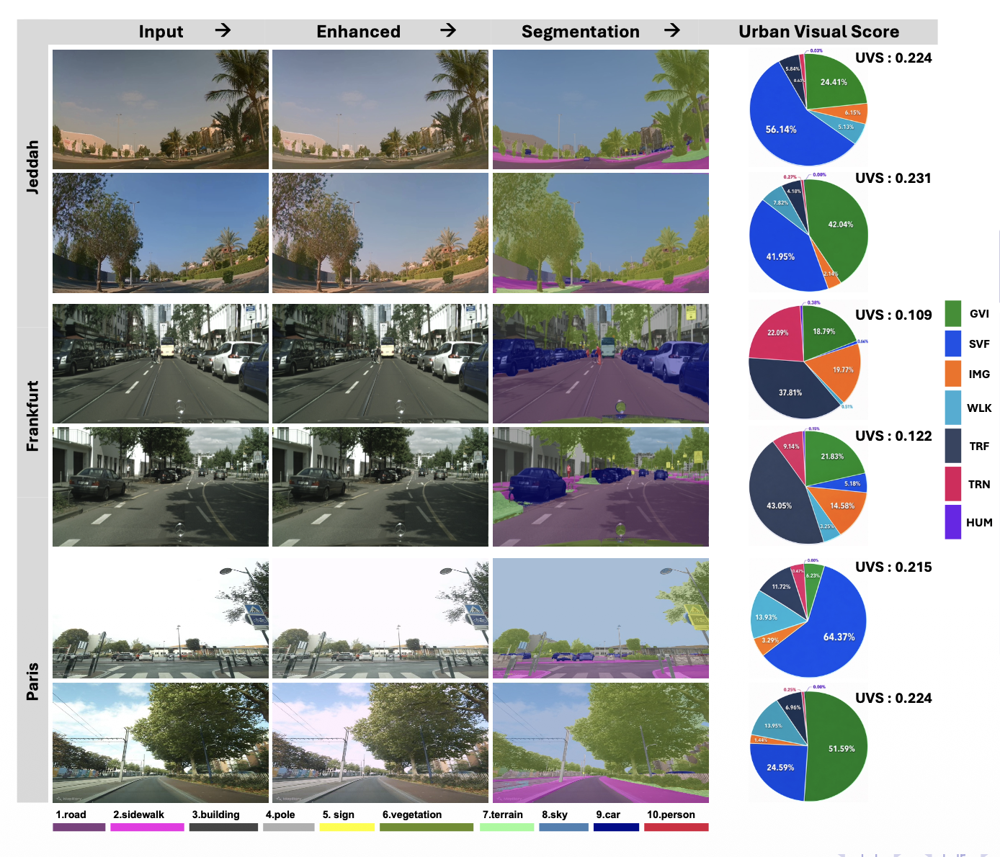

# An End-to-End Framework for Urban Planning Analysis from Street-View Imagery

Official implementation of the paper:
"An End-to-End Framework for Urban Planning Analysis from Street-View Imagery"

**Authors:**
- [Mrs. Dalia Alharbi, University of Strathclyde](https://pureportal.strath.ac.uk/en/persons/dalia-salman-b-alharbi/)
- [Dr. Mohamed Elawady, University of Strathclyde](https://pureportal.strath.ac.uk/en/persons/mohamed-elawady/)

**Conference:** 19th International Conference on Machine Vision, 15th-18th October 2026, Budapest, Hungary (ICMV 2026)

## Overview

The paper presents an end-to-end framework for urban planning analysis from street-view imagery, transforming raw dashcam video with embedded GPS data into georeferenced urban-quality maps without requiring external platform subscriptions or manual scene annotation.  

The pipeline integrates privacy-preserving anonymisation (with domain-adapted licence plate detection), OCR-based GPS extraction, spatially uniform frame sampling, colour enhancement, and semantic segmentation to derive seven appearance-based visual indicators combined into a unified Urban Visual Score (UVS).

### Framework

### Stage 1: Privacy-Preserving Anonymisation

### Stage 2: GPS Extraction and Frame Selection

### Stage 3: Colour Enhancement

### Stage 4: Semantic Segmentation

### Stage 5: Urban Visual Metrics and UVS

### Stage 6: Spatial Visualisation

### Qualitative Results

## Source Code

The **source code for the framework experiments and implementation will be released shortly**.

> 🚧 **Code release:** The repository is currently being prepared for the public release of the source code, execution configurations, and supporting resources.

## Dataset

Further details about the used data (Jeddah/Private, Frankfurt/Cityscapes, Paris/MSLS) will be provided with the code release.
